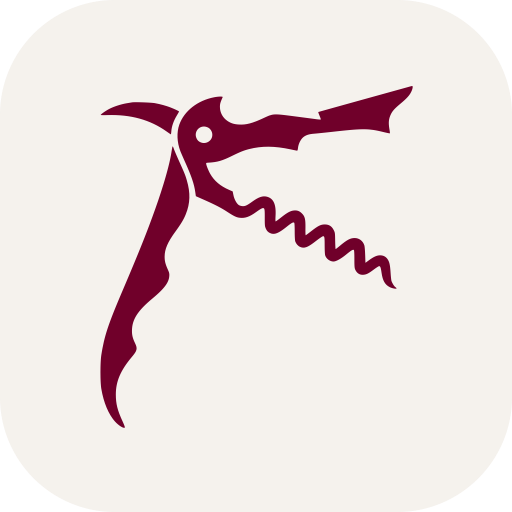
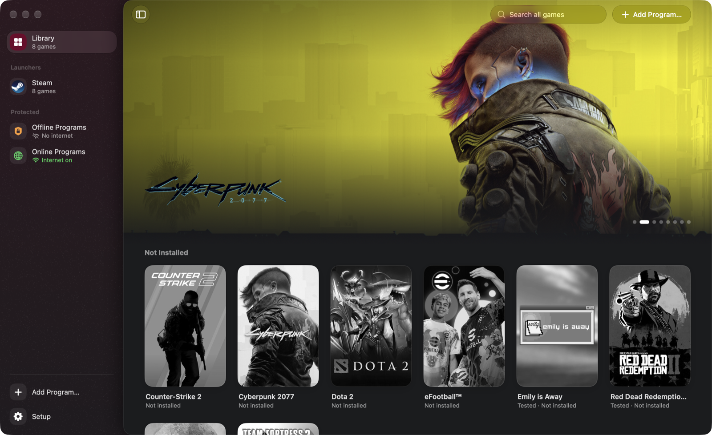
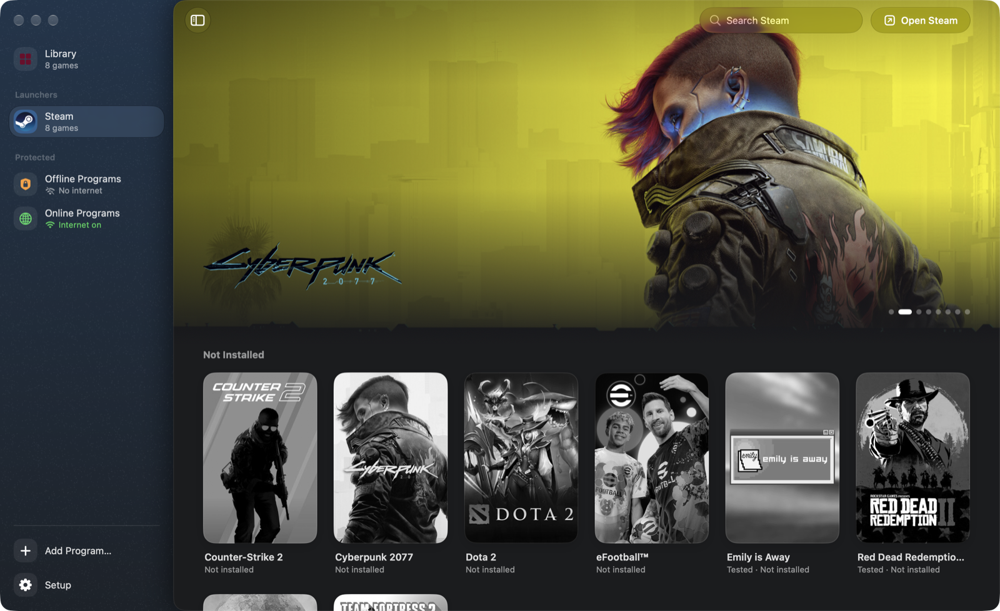
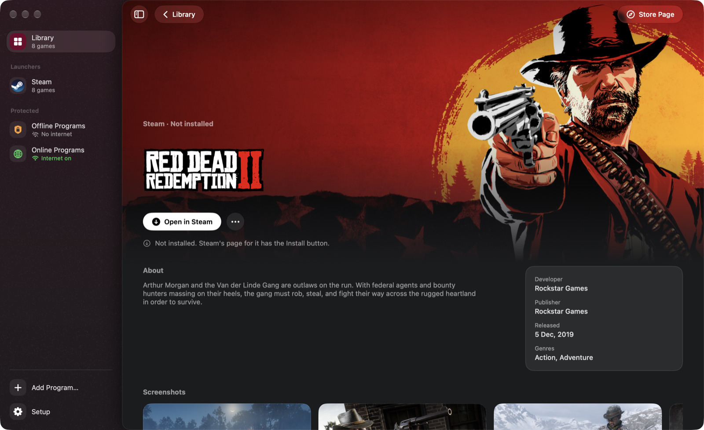
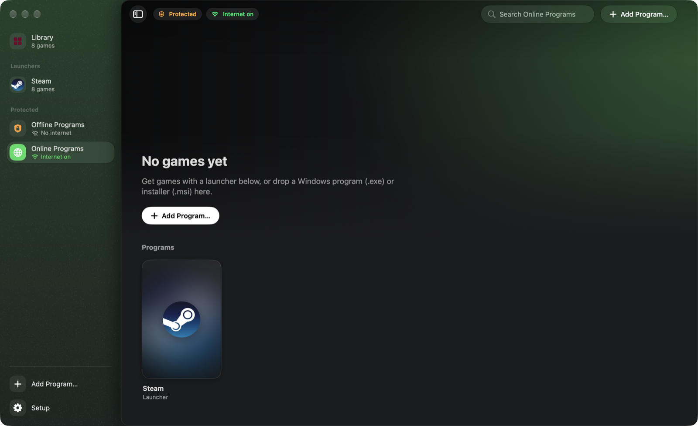

# Corkscrew

[](https://github.com/Prateek-Srivastav/corkscrew/actions/workflows/ci.yml) [](LICENSE)

**[prateek-srivastav.github.io/corkscrew](https://prateek-srivastav.github.io/corkscrew/)**

A native macOS app (Swift 6, SwiftUI) that runs Windows games and launchers on Apple Silicon Macs. It builds its own Wine runtime, picks a graphics translation layer per game, keeps programs in separate Wine prefixes ("bottles"), and can run untrusted programs inside a macOS sandbox.

It's developed and tested on a 14" MacBook Pro (M4, 16 GB, macOS 27). It runs games through their stores and launchers, and any Windows program you add. Corkscrew itself doesn't bypass DRM or copy protection. Contributions are welcome (see [Contributing](#contributing)).

| Library | Steam |
|---|---|
|  |  |
| **Game page** | **Online Programs** |
|  |  |

## Install

You need an Apple Silicon Mac with macOS 26 or 27, and about 3.5 GB of free disk space, plus space for your games.

1. Install it from Terminal:

   ```bash
   curl -fsSL https://prateek-srivastav.github.io/corkscrew/install.sh | bash
   ```

   The [script](scripts/install.sh) downloads the latest release (about 320 MB), checks its SHA-256, copies Corkscrew to Applications (replacing an older one) and opens it. When a new version is out, Corkscrew shows it when it opens: click **Update**. Or run the command again.
2. Click **Set Up Corkscrew**. It installs Rosetta if needed, unpacks the Wine runtime and graphics translators that come inside the app (checked against a built-in SHA-256), creates a Steam bottle with Steam, and makes two protected bottles for other programs: Offline Programs (no internet) and Online Programs.
3. Open Steam from the Library, sign in, and install your games. Or install a program you downloaded (below).

Apple plans to limit Rosetta after macOS 27, and the runtime needs it; an ARM64 runtime is on the [roadmap](#roadmap). To build from source, see [Building](#building).

### Install a program from a download

Corkscrew installs a program that comes as a `.zip`, `.rar`, `.7z`, `.tar.gz` or `.iso`, or as split parts (`.part1.rar`, `.r00`, `.7z.001`). You don't need an unpacking app or Terminal.

1. Drag the download onto Corkscrew's window. Or use **Add Program…** (⌘O), or **Open With → Corkscrew** in Finder. For a split download, pick any part; keep all the parts in one folder.
2. Choose the bottle (Offline Programs by default) and what happens to your file: **Copy** keeps it, **Move** deletes it after unpacking to save space. Click **Install**.
3. Corkscrew unpacks the download into the bottle. If there's a disc image, it goes into the bottle's D: drive, like a DVD.
4. Click **Run Setup** and follow the setup's steps. Keep the install folder it suggests.
5. When the setup closes, Corkscrew shows the program it installed. Check the name and click **Add to Library**. It deletes the setup files and ejects the disc.

If the download is the program itself, with no setup, step 4 is **Add to Library**. Long steps can run in the background: click **Hide**, and click the bar at the bottom to come back. Password-protected archives and split zips (`.z01`) don't work yet.

### Usage counts

Corkscrew sends a few anonymous counts that show how many people install it and on which Macs:

- **install**: from the install script, after an install or an update. It has the version, the version it replaced, macOS, the Mac model, the chip and memory, and the language.
- **first_launch**: once, the first time Corkscrew opens, with the same details.
- **setup_done**: when **Set Up Corkscrew** finishes. It has how long setup took, whether it installed Rosetta, and where Wine came from.

The counts go to [Aptabase](https://aptabase.com). Aptabase shows the country from the connection and doesn't keep the IP address. Nothing identifies you: no name, account, Apple ID, files, programs or games, and no ID that lasts (Aptabase's visitor hash changes every day). The code is in [Analytics.swift](Packages/GameCore/Sources/GameCore/Analytics.swift) and the [install script](scripts/install.sh).

To turn them off, switch off **Send anonymous usage counts** in Settings → Privacy. Or install with `DO_NOT_TRACK=1`, which also turns off the app's counts before it opens:

```bash
curl -fsSL https://prateek-srivastav.github.io/corkscrew/install.sh | DO_NOT_TRACK=1 bash
```

### Crash and error reports

When a program crashes, quits after an error message, or doesn't start, or Corkscrew itself quits unexpectedly, Corkscrew shows a report. For a crash that only the program's own handler caught, the report has the exception from its crash dump; the dump itself is never sent. An error message has a **Report…** button too. The report has what happened, the Corkscrew, macOS and Wine versions, the Mac, the bottle, the program's graphics and settings, Wine's backtrace and the end of the log. Your home folder shows as `~` and your user name as `<user>`.

Nothing is sent until you click. **Send Report** sends the report to Corkscrew's relay ([`relay/`](relay)), a small Cloudflare Worker. It keeps the whole report privately and opens a public [GitHub issue](https://github.com/Prateek-Srivastav/corkscrew/issues?q=label%3Acrash-report) with the title, the summary line, the details and the start of the backtrace; your note and the end of the log stay private. The relay doesn't keep your IP address. If sending fails, **Report on GitHub…** copies the whole report and opens a new [bug report](https://github.com/Prateek-Srivastav/corkscrew/issues/new?template=bug_report.yml) with as much of it as fits in the link; paste the rest. GitHub issues are public, so read the report first.

Corkscrew turns off Wine's crash dialog in each bottle, so Wine writes the backtrace into the launch log (**Show Log**) instead of a `backtrace.txt` you would have to save from the dialog.

### Share settings that work

After you play a Steam game for 15 minutes without a crash, with settings that aren't on the tested list, Corkscrew asks whether it ran well. **Share** sends the game, its Corkscrew settings, your notes, and your Mac and macOS to Corkscrew's [relay](relay/), which opens a public [game report](https://github.com/Prateek-Srivastav/corkscrew/issues?q=label%3Agame-report) on GitHub. You need no GitHub account. It asks once for each game and set of settings.

When a maintainer checks the report and labels it **tested**, a workflow adds the settings to [the tested list](Packages/GameCore/Sources/GameCore/Stores/tested.json) in a pull request. Corkscrew downloads that list from GitHub when it opens (offline, it uses the last list it downloaded, or the one it came with), so once the pull request is merged, everyone's copy of that game starts with them. No new release is needed. The workflow takes only the settings Corkscrew shares, and never changes the games tested here.

## What works

| Area | Status |
|---|---|
| Wine runtime | CodeWeavers' open-source Wine (winecx 26.3, Wine 11 base), built for x86_64, run under Rosetta 2 in WoW64 mode |
| Graphics | D3DMetal (Game Porting Toolkit 3.0), DXMT, DXVK with MoltenVK, and WineD3D, switchable per game; MetalFX upscaling through games' DLSS option |
| Steam | Installs, signs in, downloads and launches games, which show up in the Library by themselves; any bottle can have its own Steam |
| Rockstar Games Launcher | Starts, signs in (Social Club), and launches games |
| Isolated bottles | Programs run in a macOS sandbox with no access to your files; internet off unless you turn it on; DX11 and DX12 render inside it |
| App | Library with a tab per bottle, per-game settings, logs, Retina mode, Metal HUD and a performance overlay, Finder "Open With" for `.exe`/`.msi` |
| Programs from downloads | `.zip`, `.rar`, `.7z`, `.iso` and split archives: unpacks, mounts the disc, runs the setup and adds the program to the Library ([how](#install-a-program-from-a-download)) |
| Game controllers | Xbox controller works in every tested game (not tried yet in Last Pirates Die Together), through Wine's SDL2 support |
| Game Mode | Turns on for fullscreen games in standard bottles |

### Games tested

| Game | Setup | Result |
|---|---|---|
| **Red Dead Redemption 2** | Steam → Rockstar Games Launcher, DX12 on D3DMetal | Plays at about 50 FPS (25 in Retina mode) with the tested settings: Ultra textures, High shadows and lighting, DLSS as MetalFX. |
| **Black Myth: Wukong Benchmark Tool** | Steam, DX12 + MetalFX on D3DMetal | 50 FPS average at 1512×982 (Medium, MetalFX 59%), or 33 FPS at Retina 3024×1964. |
| **God of War (2018)** | Isolated bottle, internet off, DX11 on D3DMetal with a depth-test fix | Plays with the tested settings (Ultra preset, HDR off, no film grain), with no white specks on the characters ([#14](https://github.com/Prateek-Srivastav/corkscrew/issues/14)). |
| **FIFA 23** | Isolated bottle, internet off, DX12 on D3DMetal, AVX on | Starts and reaches its first menu, full screen with no crop. Needs engine pack 26.3.0-6: loopback inside the bottle ([#40](https://github.com/Prateek-Srivastav/corkscrew/pull/40)) and emulated display modes ([#42](https://github.com/Prateek-Srivastav/corkscrew/pull/42)). |
| **Last Pirates Die Together** | Isolated bottle, internet on, with its own Steam; DX11 on D3DMetal | Plays; online co-op works. |
| **Emily is Away** | 32-bit, DX11 on DXVK | Runs |

## How it works

```
Corkscrew.app (SwiftUI) · gamecore-cli
  └─ GameCore: Inspect (PE parser) · Graphics (backend choice) · Engines · Bottles
               Isolation (sandbox) · Stores (Steam, Rockstar) · Launch · Performance
       └─ winecx 26.3 (x86_64, Rosetta 2)
            └─ D3DMetal · DXMT · DXVK + MoltenVK · WineD3D → Metal
```

- **Graphics per launch.** Backend DLLs live outside Wine's own folder; each launch points `WINEDLLPATH` at the chosen one. 64-bit DX12/11 games get D3DMetal, other DX11/10 games DXMT. God of War gets D3DMetal (or DXMT) behind a small d3d11.dll (`tools/depth-equal-fix`) that fixes its depth test; the launch puts it next to the game.
- **Tuned for speed.** msync instead of wineserver waits, no Wine debug output, Game Mode, Steam's overlay off unless a game needs it, background shader compiles. `scripts/bench.sh` measures the overhead.
- **Bottles stay current.** A bottle is updated (`wineboot --update`) when the runtime changes.
- **Isolated bottles** run everything under a generated Seatbelt profile:
  - nothing outside the bottle is writable, and your home folder and other disks can't be read;
  - programs start only from the runtime, never through LaunchServices or launchd;
  - AppleEvents, the keychain, the clipboard and (by default) the network are blocked;
  - with the network blocked, programs can still use loopback, but only to listeners in their own bottle;
  - drive links out of the bottle are removed, and "Reset to Clean" restores a snapshot;
  - the Mac's root certificates are copied into the bottle, so HTTPS works without keychain access.

The development history, including the fixes RDR2 needed, is in [docs/HISTORY.md](docs/HISTORY.md).

## Building

You need an Apple Silicon Mac with macOS 26 or later, about 8 GB of free space, Rosetta 2 (`softwareupdate --install-rosetta --agree-to-license`), Xcode 26 or later (opened once), and [Homebrew](https://brew.sh). For DX12 games, also download **Game Porting Toolkit 3.0** from [Apple](https://developer.apple.com/games/game-porting-toolkit/).

```bash
git clone https://github.com/Prateek-Srivastav/corkscrew.git
```

Then, from the `corkscrew` folder, run these in order. The runtime build is the long step; if it stops, run it again and it continues.

```bash
scripts/bootstrap.sh
```

```bash
scripts/build-deps.sh
```

```bash
scripts/build-runtime.sh
```

```bash
scripts/install-components.sh ~/Downloads/Game_Porting_Toolkit_3.0.dmg
```

```bash
scripts/build-app.sh Debug
```

```bash
open build/DerivedData/Build/Products/Debug/Corkscrew.app
```

Open it from there the first time: it finds the runtime and components in `build/` and sets itself up. Every download is checked against the SHA-256 in `scripts/runtime-pins.env`.

**After `git pull`**, run `scripts/build-app.sh Debug` again. If `scripts/build-runtime.sh` or `scripts/runtime-pins.env` changed, delete `build/src/crossover-*`, rebuild the runtime, and run `scripts/install-components.sh` again.

**Tests:** `scripts/test.sh` (no runtime needed). For the graphics smoke test, run `scripts/make-fixtures.sh` then `scripts/smoke.sh`; `scripts/bench.sh` times Win32 calls and D3D11 draws per backend.

## Using it

- **Steam games** appear in the Library once installed. Tested games are listed under **Not Downloaded** from the start; their button opens them in Steam.
- **Downloaded programs** (`.zip`, `.rar`, `.7z`, `.iso`): see [Install a program from a download](#install-a-program-from-a-download).
- **Other programs:** drag in an `.exe` or `.msi`, use Finder's "Open With", or **Run Program…** in a bottle. Choose **Run Once** for installers and **Add to Library** for programs you open again.
- **Per-game settings:** graphics backend, MetalFX, Retina mode, Metal HUD, performance overlay, Steam overlay, launch arguments and logs.
- **Untrusted programs:** create an **Isolated** bottle under Bottles → New Bottle. Turn on **Install Steam** if a program needs Steam; use a second Steam account there, because programs in the bottle can read its sign-in.
- **Data** lives in `~/Library/{Application Support,Logs,Caches}/Corkscrew`; pass `-DataRoot <folder>` to keep it in one folder. Bottles, runtimes and components are in `.noindex` folders, which Spotlight doesn't index.
- **Uninstall:** **Settings → Clean Up and Uninstall** stops every bottle, deletes the bottles with the programs in them, Wine, the library, logs, caches and settings, then deletes the app.
- **CLI** (`swift build` in `Packages/GameCore`, run from the repository root): `gamecore-cli bottle create <name> [--isolated]`, `inspect <exe>`, and `run --bottle <name> [--backend d3dmetal] [--metalfx] [--hud] [--retina] [--verbose] [--env KEY=VALUE] <exe>`.

If something doesn't work, check [Known issues](#known-issues), then the game's log under **Logs** in its panel.

## Known issues

- **Isolated bottles use `sandbox-exec`**, which Apple has deprecated. It works on macOS 26 and 27, and the tests check the sandbox, but a future macOS could remove it. ([#6](https://github.com/Prateek-Srivastav/corkscrew/issues/6))
- **RDR2 crashes after changing graphics settings in game** ("No DirectX 12 adapter or runtime found"). Change settings, then quit and relaunch. ([#7](https://github.com/Prateek-Srivastav/corkscrew/issues/7))
- **The Rockstar launcher sometimes can't reach its library service.** Close it and play again. ([#8](https://github.com/Prateek-Srivastav/corkscrew/issues/8))
- **Networks that intercept TLS** break Steam downloads and put the Rockstar launcher offline. ([#9](https://github.com/Prateek-Srivastav/corkscrew/issues/9))
- **FSR 3 Frame Generation crashes DX12 games on D3DMetal.** Keep it off; DLSS (MetalFX) works. ([#10](https://github.com/Prateek-Srivastav/corkscrew/issues/10))
- **GPTK 4.0 beta 2 draws Wukong's textures as blocks** (an Apple bug), so stable 3.0 is the default. ([#11](https://github.com/Prateek-Srivastav/corkscrew/issues/11))
- **Steam's UI looks half-size in Retina mode**, because Windows DPI stays at 96. ([#12](https://github.com/Prateek-Srivastav/corkscrew/issues/12))
- **D3DMetal's shader cache** is shared by every bottle and GPTK version. ([#13](https://github.com/Prateek-Srivastav/corkscrew/issues/13))

## Roadmap

- **M3:** game profiles. **Isolation:** a blocked-actions panel and a network-block check.
- **M4:** shortcuts and controller settings. **M5:** Epic Games and Battle.net launchers.
- **M6:** an ARM64 Wine with FEX for x86 emulation, before Rosetta 2 is retired.
- **Distribution:** Developer ID signing and notarization.

## Contributing

Bug fixes, game reports and new launcher support are welcome. Read [CONTRIBUTING.md](CONTRIBUTING.md) first, report games with the **Game report** issue form, ask in [Discussions](https://github.com/Prateek-Srivastav/corkscrew/discussions), report security problems as in [SECURITY.md](SECURITY.md), and follow the [Code of Conduct](CODE_OF_CONDUCT.md).

## License

Corkscrew is free software: you can redistribute it and modify it under the terms of the [GNU General Public License](LICENSE), version 3 or (at your option) any later version. It comes with no warranty.

## Credits and licenses

This repository only contains Corkscrew's own code. The build scripts download each third-party component at build time, check it against `scripts/runtime-pins.env`, and keep it under `build/` (not in git). The released app carries them as an **engine pack** (`Contents/Resources/EnginePack`) with their licenses; `scripts/package-engine.sh` makes it, and each pack is published as a `runtime-*` release with the source of everything in it.

| Component | Used for | License |
|---|---|---|
| [Wine](https://www.winehq.org), CodeWeavers' source (winecx 26.3.0) | Windows compatibility layer | LGPL 2.1 or later |
| [DXMT](https://github.com/3Shain/dxmt) 0.80 | Direct3D 10/11 → Metal | MIT |
| [DXVK-macOS](https://github.com/Gcenx/DXVK-macOS) 1.10.3 | Direct3D 9/10/11 → Vulkan | zlib/libpng |
| [MoltenVK](https://github.com/KhronosGroup/MoltenVK) 1.4.2 | Vulkan → Metal | Apache 2.0 |
| [Wine Mono](https://gitlab.winehq.org/mono/wine-mono) 10.4.1 | .NET in bottles | MIT, some parts under other open-source licenses |
| [FreeType](https://freetype.org) 2.13.3 | Fonts | FreeType License or GPL 2 |
| [GnuTLS](https://gnutls.org) 3.8.13 | TLS | LGPL 2.1 or later |
| [Nettle](https://www.lysator.liu.se/~nisse/nettle/) 3.10 and GMP | Cryptography for GnuTLS | LGPL 3 or GPL 2 |
| [SDL2](https://libsdl.org) 2.32.10 | Game controllers | zlib |
| [Swift Argument Parser](https://github.com/apple/swift-argument-parser) | `gamecore-cli` | Apache 2.0 |
| D3DMetal, from Apple's [Game Porting Toolkit](https://developer.apple.com/games/game-porting-toolkit/) 3.0 | Direct3D 11/12 → Metal | Apple's license (`Apple-License.rtf`, `Apple-Acknowledgements.rtf`). Not open source and not covered by Corkscrew's GPL. Its `redist` components may be redistributed only for non-commercial purposes, with Apple's notices: the free engine pack includes them, and anything that sells Corkscrew must leave them out. |

**Our changes to Wine** are patches applied by `scripts/build-runtime.sh`: the loader's Info.plist (bundle identifier, Game Mode keys); starting programs from an app bundle so Game Mode turns on; an opt-out of the loader's re-exec link for sandboxed bottles; `--in-process-gpu` for Rockstar's Social Club; full-screen windows at the normal window level, for Mission Control (winemac); no input hang when a program destroys a D3DMetal window on another thread (winemac); VirtualProtect on D3DMetal's functions for games with mod hooks on (ntdll); display modes up to the panel's pixel size when mode changes are emulated (win32u); and loopback only to the bottle's own listeners in offline bottles (wineserver).

Steam, Rockstar Games, Red Dead Redemption, Black Myth: Wukong, God of War, FIFA, DirectX, DLSS, FSR, Metal and other names are trademarks of their owners. Corkscrew isn't affiliated with or endorsed by any of them.
